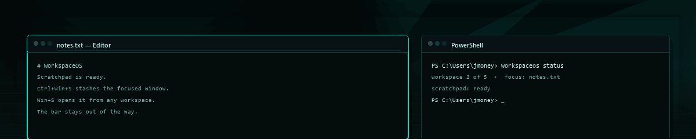
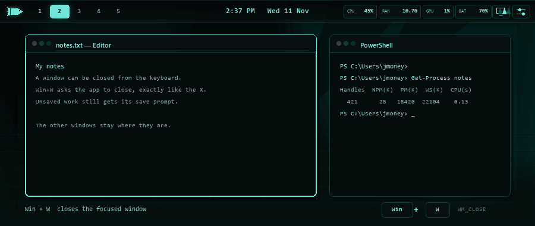

# WorkspaceOS

**The Shibumi shell, on Windows 10/11** — the single-run Shibumi bar, plugin widgets and detail panels of [Shibumi-Shell](https://github.com/HANCORE/Shibumi-Shell), ported to WPF and bound to Windows: native virtual desktops, Core Audio, WMI sensors, powercfg, and the fourteen Omarchy themes.

> **New in v5.2.0 — glass everywhere, and payloads that match the docs.**
>
> - **File Explorer is glassy too.** Explorer paints its own opaque XAML tree, so the app themes it through Windhawk's `windows-11-file-explorer-styler`: the `WindowGlass` theme with a real `acrylicblur` backdrop, and both of the theme's solid background constants — `MainContentBG` (file list, Home, Gallery) and `Background` (menus and command-bar flyouts) — replaced by a `WindhawkBlur` in the theme's paper colour. The wallpaper shows blurred through the title bar, command bar, sidebar and file list, and the tint follows every theme change without restarting the Windhawk engine. `MainContentBG` was the missing piece: with the theme alone the file list stays an opaque panel.
> - **The glass cannot desynchronise the shell.** The taskbar and Explorer presets are applied in **one** elevated run, new values are written **before** stale ones are pruned, and the change is announced last — so the Explorer styler never re-initialises a window against a half-written settings set. That ordering was the cause of a one-off `explorer.exe - System Error` ("Exception Processing Message 0xc0000005") when a theme was applied over open windows.
> - **The Windows payloads ship the script they tell you to run.** `tools\apply-windhawk-taskbar.ps1` is embedded in the installer, included in the portable zip, and it now finds the compiled styler library Windhawk registered instead of a build number from someone else's machine. The installer's version string is generated from the csproj, so it can no longer name an older release.
>
> **Previously, in v5.1.0 — the Shibumi release.**
>
> - **Keybindings that hold up.** `Win+Shift+5..9` now send a window to workspaces 5–9 (only 1–4 shipped before), Aero Snap has `Win+Arrow` back instead of fighting the window nudges, `Win+Shift+Arrow` moves between monitors, and the theme picker, audio panel and scratchpad chords are all in one documented table. The shipped table is tested: no chord twice, every workspace reachable both ways.
>
> - **The Shibumi shell, ported.** The default V1 form is one 32 px island inside a 35 px strip, inset 5 px with a 16 px radius, 24 px pills and a 5 px breathing gap below the island so maximized windows never touch it. Paper, ink and sumi use the suite's own tokens; the launcher assets (**SHIBUMI**, **Omarchy**, **Hyprland**, **Arch**, **OMACOM**, Dragon and the Shibumi mark) are the real ones from the fork. The plugin catalogue is generated from its manifests. **Shibumi shell** in the bar menu moves or hides any widget.
> - **Real Windows backends.** CPU, memory, GPU, storage and temperature from the metrics service; audio from Core Audio; network from Win32; battery from `GetSystemPowerStatus`; brightness from WMI; power profiles from `powercfg`; Bluetooth from the radio API. Every pill opens its Shibumi panel.
> - **Themes reach the whole PC.** One apply writes the wallpaper once to every monitor and virtual desktop, the Windows accent colour, the light/dark app mode, the bar palette and the Windhawk taskbar preset — and re-asserts it at startup.
> - **Tiling is gone.** No GlazeWM, no administrator prompt, no window manager fighting your drags. `Win+1..9` are native virtual desktops again, driven by the bundled AutoHotkey bridge.
>
> - **Fourteen Omarchy themes** ship in the bar, including **Gold Rush**, **Harbor**, **Harbor Dark**, **Matte Black**, **Vantablack** and **Pokemon**, cycled with **`Ctrl+Win+Shift+Space`**. Drop any Omarchy `colors.toml` into `%APPDATA%\WorkspaceOS	hemes\<name>\` and it joins the cycle.
> - **A bar that changes shape.** **Shibumi** (default), **Full**, **Fit**, **Dock** and **Notch**, switched from the logo menu at the bar's left edge — the same menu holds the theme list and the real Shibumi launcher marks (SHIBUMI by default).
> - **cava in the bar.** Your own `cava.exe` feeds a live audio widget painted in the theme's colours, without touching your cava config.
> - **A themed taskbar.** On Windows 10 / a classic taskbar, WorkspaceOS sets the taskbar's own accent policy (clear, blur or acrylic, theme-tinted). Windows 11 22H2+ ignores that API, so the app detects the XAML taskbar and writes the matching `windows-11-taskbar-styler` preset; install the styler mods once from Windhawk's own mod list, then run the bundled `tools\apply-windhawk-taskbar.ps1` once elevated to apply the theme's glass and register the task that re-applies it. `diag` then reports `windhawk=enabled`, and the blurred taskbar follows every theme change without another prompt. **File Explorer** gets the same glass through Windhawk's `windows-11-file-explorer-styler` mod — install it once from Windhawk's mod list and WorkspaceOS stages and applies its preset with that same task, so Explorer is tinted in the theme's paper and re-tints on every theme change.
>
> **v4.8.0:** `Win+Space` opens the launcher again, and Windows 10 is detected by build number with classic blur before 2004. **v4.7.1:** the scratchpad survives restarts. **v4.7.0:** the in-app screenshot tool is gone, so `Win+Shift+S` is Snipping Tool again.

-blue) 



*The live bar: the active-workspace pill slides between slots, the clock fades when the minute changes, and the CPU/RAM/GPU readings ease to their next values. The surface is translucent acrylic; the palette comes from the active Omarchy theme.*



*`Win+W` closes the focused window — apps get their normal save/exit path (it sends
`WM_CLOSE`, the same as the title-bar ✕). Rebindable in Settings → Hotkeys.*

## Features

- **New windows open maximized once** — one native maximize when a normal app window opens, then the window stays movable and resizable; games, dialogs and tool windows are skipped
- **Workspaces on Windows' native Virtual Desktops** (`Win+1..9`) — the same real desktops as `Ctrl+Win+Arrow` and Task View, on **every Windows 10/11 build** (the shell's virtual-desktop interfaces are bound per OS build: Win10, Win11 pre-24H2, 24H2/25H2). The hotkeys are captured by a **bundled AutoHotkey v2 runtime**, so the shell's taskbar shortcuts never fire; nothing about your taskbar is modified
- **The Shibumi bar** — one continuous 32 px island inside a 35 px appbar, with a 5 px gap before maximized windows: the SHIBUMI mark, workspace numbers and CPU/memory/audio on the left; the clock and cava in the centre; quick access, network, battery, brightness, power profile and the control centre on the right. Every pill opens its own Shibumi panel, and the bar hides and returns its screen space while a fullscreen game or browser video is in front
- **A themed taskbar** — on Windows 10 and classic taskbars, the appbar surface is set directly (clear, blur or acrylic, tinted with the theme's paper; `Dynamic` follows the desktop and maximizes). Windows 11 22H2+ draws a XAML taskbar that ignores that API, so WorkspaceOS writes the matching Windhawk `windows-11-taskbar-styler` preset and ships `tools\apply-windhawk-taskbar.ps1` to enable the mod with one elevation. That script also registers a highest-privileges task, so the theme's tint is re-applied on every later theme change without prompting. The taskbar is genuinely translucent over bright and dark windows, and no DLL is injected by WorkspaceOS itself. File Explorer paints an opaque XAML background, so its glass comes from Windhawk's `windows-11-file-explorer-styler` mod: install it once from Windhawk's mod list, and the app writes its preset (`%APPDATA%\WorkspaceOS\explorer\`) and applies it through the same scheduled task
- **A configurable plugin suite** — the catalogue is generated from Shibumi-Shell's own `manifest.json` files (G1–G18, ids, roles, sections, descriptions). **Shibumi shell** in the bar menu moves a widget between left/centre/right or hides it, and sets bar height, pill geometry, frost, borders and panel shadow
- **Omarchy themes with cycling** — fourteen built-ins plus drop-in `colors.toml` folders, cycled with `Ctrl+Win+Shift+Space`. One theme repaints the bar, the panels, the cava widget, the Windows accent and app mode, the taskbar preset and the wallpaper on **every monitor and virtual desktop** (one shell call, verified per monitor — never applied twice)
- **Bar forms and logos** — Full, Fit, Dock and Notch, plus the real Shibumi launcher assets (SHIBUMI, Omarchy, Hyprland, Arch, OMACOM, Dragon and the Shibumi mark, or your own image), from the logo menu at the bar's left edge
- **Focus follows mouse** — rest the pointer on a normal app window for 120 ms to focus it without clicking. After a workspace switch, the window under the pointer gets focus immediately, so typing or `Ctrl+T` goes to the app you just revealed. Games, drags, the bar, taskbar and desktop are ignored; toggle it in **Settings → Advanced**
- **Scratchpad** — stash the focused window with `Ctrl+Win+S`, then open or close it from any workspace with `Win+S`. Press `Ctrl+Win+S` again while the scratchpad window is focused to take it back out. The stashed window is pinned across native desktops while it is stashed and is restored when WorkspaceOS exits
- **System monitor dashboard** — CPU, memory, GPU/VRAM, disk space & speed, network, top processes
- **Window rules** — auto-assign apps to workspaces
- **Window commands** — `Win+W` close, `Win+M` maximize, `Win+Shift+M` restore, `Win+C` center, `Win+F` fullscreen, `Win+Shift+Arrow` move across monitors
- **Focus Mode** (`Win+F1`), **Launcher** (`Alt+Space`), **Clipboard manager** (`Win+V`). `Win+Shift+S` is deliberately left to the native Snipping Tool
- **Everything configurable** — colors, fonts, hotkeys, workspace rules; JSON config with export/import

## Install

1. Download **WorkspaceOS-Setup.exe** from the [latest release](../../releases/latest)
2. Run it (per-user install, no admin required)
3. Done — WorkspaceOS starts immediately and on every login

Everything is bundled: **64-bit Windows 10/11 (x64)**, no admin rights, no .NET
runtime install, and no separate AutoHotkey install. Use the portable zip if you
prefer not to install; it contains the app plus its AutoHotkey runtime. The
self-contained x64 build also runs on Windows 11 ARM64 through x64 emulation;
32-bit Windows is not supported.

### Install from source (no SmartScreen prompt)

If a downloaded `.exe` is blocked or warned about, build it here instead — one
line in PowerShell, no admin rights, nothing prebuilt:

```powershell
powershell -NoProfile -ExecutionPolicy Bypass -Command "irm https://raw.githubusercontent.com/Johnnycarriere215/Workspace-Os/main/tools/install-from-source.ps1 | iex"
```

It installs the .NET 8 SDK per user if it is missing, checks the repository out
under `%LOCALAPPDATA%\WorkspaceOS\source` (git when present, GitHub's source zip
otherwise), runs the tests and `build.ps1`, then installs the result to
`%LOCALAPPDATA%\Programs\WorkspaceOS` the same way the setup exe does: Start-menu
shortcut, start at login, and an entry in Settings → Apps. The executable is
compiled on the machine from the source you can read, so it carries no
Mark-of-the-Web and no "unknown publisher" prompt appears.

Run it as a file to pass options:

```powershell
tools\install-from-source.ps1 -SkipInstall   # build only, leave it in <root>\publish
tools\install-from-source.ps1 -NoLaunch      # install without starting the app
tools\install-from-source.ps1 -Branch main -Root D:\src\WorkspaceOS
```

Needs 64-bit Windows 10 1809+ and an internet connection (the SDK, git or the
GitHub zip, and the AutoHotkey runtime `build.ps1` fetches). It replaces an
existing install in place and keeps `%APPDATA%\WorkspaceOS` settings.

### Windows 10

WorkspaceOS targets **Windows 10 (1607 → 22H2) and Windows 11** from the same x64
binary:

- The OS is identified by **build number**, never the registry's `ProductName` —
  Windows 11 still reports itself as "Windows 10 Home/Pro" there.
- Virtual desktops bind the **Windows 10** shell interface set (`win10` in
  `workspaceos.log`), which is what Windows 10 1607 through 22H2 expose.
- **Windows 10 1809 and newer** get the dark title bar on Settings; older 10
  builds keep the light caption.
- **Before Windows 10 2004 (build 19041)** the bar asks for classic blur-behind
  instead of acrylic, whose compositor drag-lags on 1803–1903. The translucent
  tint is kept, so the glass look survives.
- The appbar strip, focus-follows-mouse, fullscreen detection, scratchpad and
  workspaces all use the same code path on 10 and 11.

**Upgrading from 2.x / 3.x / 4.x:** install over the top — the installer stops the
old version and your settings are kept. Obsolete tiling hotkeys and the `Tiling`
config section are removed automatically on Windows.

> Silent install: `WorkspaceOS-Setup.exe /S` · Uninstall: Add/Remove Programs, or `Uninstall.exe /uninstall`
>
> On Linux? Version 3.0 ships a **native** `.deb` — no Wine, no Windows binaries — see [Linux install](#linux-install-native-deb).

## Setup tutorial (Windows, step by step)

First run, in order:

1. **Install** (above). The top bar appears at the top of the screen and WorkspaceOS
   starts with Windows. The installer bundles everything; no admin rights needed.
2. **Try workspaces.** Press `Win+2`, `Win+3`, … — the bar highlights the active
   workspace and every window you open belongs to the one you're on.
3. **Send a window somewhere.** Focus any window and press `Win+Shift+2` — it moves
   to workspace 2 and you follow it (configurable: `FollowMovedWindow`).
4. **Close a window from the keyboard.** `Win+W` sends the same close request as the
   title-bar X — apps with unsaved work will ask before quitting.
5. **New apps open maximized.** A normal app window fills the work area once;
   drag its title bar or press `Win+Shift+M` to restore it, then move and resize it
   normally. Games that are already fullscreen are left alone, and the bar hides
   and releases its reserved strip while one is in front. `Win+Shift+Arrow`
   moves the focused window to the next monitor without changing how it is drawn.
   Rest the pointer on any normal window for 120 ms to focus it without clicking; after a workspace switch, the window under the pointer is focused immediately.
6. **Make it yours.** Everything — bar colors/fonts, hotkeys, window rules,
   workspace names, per-app rules — lives in Settings. Advanced users can edit
   `%APPDATA%\WorkspaceOS\config.json` directly (see
   [docs/CONFIGURATION.md](docs/CONFIGURATION.md)).
7. **Verify hotkeys work.** See the AutoHotkey section below — this is the one part
   of setup that can genuinely need attention.

### AutoHotkey: what it does and how to set it up

**Do I have to install AutoHotkey first? No.** The installer and the portable
zip both **bundle** the AutoHotkey v2 runtime (`AutoHotkey64.exe`). Out of the
box you never download or install anything — route A below needs no action.
A manual install (route D) or a custom path (route C) is only for special
setups; and if the runtime is ever missing, WorkspaceOS still works and falls
back to its built-in keyboard hook.

**Why it exists.** Windows hard-codes `Win+0..9` to launch/activate taskbar-pinned
apps, and the shell always wins the `RegisterHotKey` race for those combos. Rather
than modifying your taskbar, WorkspaceOS ships a tiny **AutoHotkey v2 script** whose
only job is to see `Win+3` first, swallow it, and tell WorkspaceOS over a named pipe.
The app does all the work; the script holds no logic. AutoHotkey is also more reliable
than the built-in hook for every other binding, so the generated script covers all of
your hotkeys, not just `Win+1..9`.

**Pick ONE of these routes (A is the default and needs no action):**

- **A — Bundled (recommended).** Both the installer and the portable zip ship
  `AutoHotkey64.exe` (v2). It is found automatically next to `WorkspaceOS.exe` or in
  an `AutoHotkey\` subfolder. Nothing to download, nothing to install.
- **B — Built from source.** `build.ps1` downloads the runtime into
  `publish\AutoHotkey\` automatically, so a from-source build is self-contained too.
- **C — Custom path.** Install AutoHotkey v2 wherever you like, then in Settings →
  Advanced set "AutoHotkey path" to the full path of `AutoHotkey64.exe` and press Save
  (stored as `Automation.AutoHotkeyPath` in config.json). Use this if you keep runtimes
  on a different drive or want a specific version.
- **D — System-wide install.** Install [AutoHotkey v2](https://www.autohotkey.com/download/)
  normally. WorkspaceOS finds it on `PATH` or at
  `%ProgramFiles%\AutoHotkey\v2\AutoHotkey64.exe`.

Resolution order when starting: config path → bundled (next to the exe, or
`AutoHotkey\` subfolder) → `PATH` (`AutoHotkey64.exe`, then `AutoHotkey.exe`) →
`%ProgramFiles%\AutoHotkey\v2\AutoHotkey64.exe`.

**Verify it is running:**

1. Settings → Advanced → AutoHotkey status should read **Running**.
2. Press `Win+2`: the bar should switch to workspace 2 — and no taskbar app launches.
3. Settings → Advanced shows `AutoHotkey: running ✓ … 9/9 workspace chords … captured 1` and
   `last: key:Workspace2 at HH:mm:ss`. The log at `%APPDATA%\WorkspaceOS\workspaceos.log`
   shows `AutoHotkey: script written (N hotkeys, workspace chords 9/9)` and one
   `Hotkey: key:Workspace2` line per physical press. Only the AHK script's `key:` verb
   increments the counter; manual `action:` commands execute without inflating it, so
   `captured` is evidence that a real chord reached the bridge. `diag` and `hotkeys`
   report the same counters, so a key that is not captured is visible instead of a guess.

**If it is not running:** open Settings → Advanced, make sure "Run bundled AutoHotkey"
(`Automation.EnableAutoHotkey`) is enabled and press Save — the bridge restarts and the
script is regenerated from your current bindings. If the status stays off, the log
says why (missing runtime vs. start failure). WorkspaceOS never stops working without
it: the built-in low-level hook takes over, but the shell usually keeps `Win+1..9`
in that mode — which is exactly what the bridge exists to fix.

**Security software:** some AV/EDR products block low-level keyboard hooks,
including AutoHotkey's. The log will show the hook failure and WorkspaceOS falls
back automatically. Allowlisting `AutoHotkey64.exe` restores full capture.

### What the AutoHotkey bridge does behind the scenes

1. At startup (and whenever you change a hotkey) the app generates
   `%APPDATA%\WorkspaceOS\workspaceos.ahk` from your bindings.
2. The bundled runtime runs it; the script captures each chord and sends one line
   (e.g. `ws:3`, `focus:left`, `CloseWindow`) over the
   `\\.\pipe\WorkspaceOS.Ctrl` named pipe.
3. Lifecycle is handled for you: single instance, stray processes from crashed
   sessions are killed, restart with backoff if it dies, a watchdog restarts it if
   it silently stops, and it shuts down with the app.

## Linux install (native .deb)

Since 3.0.0 the `.deb` is a **native Linux daemon** (`workspaceos_<version>_amd64.deb`):
no Wine, no Windows binaries. It compiles the same Dwindle layout core and reads the
same `config.json` as the Windows build, and drives your existing desktop through the
standard X11 tooling (wmctrl/xdotool/xprop, pulled in as dependencies).

**Keybindings are set up automatically.** There is no AutoHotkey equivalent to install
on Linux: on install and at every login the daemon registers your WorkspaceOS keymap
**directly with your desktop environment** — Cinnamon custom keybindings on Linux Mint,
MATE run-commands, or a generated `xbindkeys` config elsewhere. Your desktop captures
`Win+1..9`, `Win+H/J/K/L`, … and runs `workspaceos action <Name>`; the daemon does the
rest. Edit a hotkey in `~/.config/WorkspaceOS/config.json` and the keymap is
re-applied automatically — no relogging, no manual binding editor.

**Steps (Linux Mint 21.x / 22.x, or Ubuntu/Debian):**

1. **Download the `.deb`** from the [latest release](../../releases/latest), e.g.
   `workspaceos_5.0.0_amd64.deb`.

2. **Install it** — apt pulls in `wmctrl`, `xdotool`, `x11-utils`, … automatically:

   ```bash
   sudo apt install ./workspaceos_5.0.0_amd64.deb
   ```

3. **That's it.** The keymap is live immediately (the installer registers it with
   your running session), and the daemon autostarts at login (systemd user service
   plus XDG autostart). `Win+1..9` switch workspaces, `Win+W` closes the focused
   window, and so on — same defaults as Windows.

4. **The Linux daemon is a separate X11 port.** It still includes its own
   Dwindle tiling; the Windows app no longer does. To turn it off on Linux:

   ```bash
   workspaceos action ToggleTiling
   ```

   or set `"Tiling": { "EnableTiling": false }` in `~/.config/WorkspaceOS/config.json`.
   Controls: `Win+H/J/K/L` focus, `Win+Shift+H/J/K/L` move,
   `Win+Ctrl+H/J/K/L` resize, `Win+Shift+Space` float, `Win+P` togglesplit.

**CLI** (all of it talks to the daemon over `$XDG_RUNTIME_DIR/workspaceos.sock`):

| Command | What it does |
|---|---|
| `workspaceos start` | launch the daemon (this is what the menu entry runs) |
| `workspaceos status` | daemon reachable? tiling on/off |
| `workspaceos keys` | show the active keymap as registered on X11 |
| `workspaceos retile` | force a re-tile of the current workspace |
| `workspaceos action CloseWindow` | run any named hotkey action |

**Requirements & limitations:**

- X11 sessions (Cinnamon, MATE, XFCE, and other EWMH window managers). On Wayland
  sessions the daemon manages Xwayland windows only — native Wayland capture is not
  implemented yet.
- Workspaces are the desktop's native virtual desktops; the tiling engine keeps one
  tree per (workspace × desktop) like on Windows.
- No AutoHotkey, no Wine, no .NET runtime to install: the deb ships a self-contained
  single-file daemon.

**Uninstall:**

```bash
sudo apt remove workspaceos
# optional: removes your WorkspaceOS config
rm -rf ~/.config/WorkspaceOS
```

## Default keybindings

Every binding is editable in **Settings → Hotkeys** and stored in `Hotkeys.Bindings`. Clear a field to disable that action. These are the chords a fresh install gets — `tests/WorkspaceOS.Tests/HotkeyDefaultsTests.cs` keeps them honest (no chord twice, every workspace reachable both ways).

### Workspaces

| Keys | Action |
|---|---|
| `Win+1` … `Win+9` | Switch to workspace 1–9 (AutoHotkey-intercepted; taskbar apps do NOT open) |
| `Win+Shift+1` … `Win+Shift+9` | Send the focused window to workspace 1–9 |

### Windows

| Keys | Action |
|---|---|
| `Win+W` | Close focused window (sends `WM_CLOSE` — apps get their save/exit path) |
| `Win+M` | Maximize |
| `Win+Shift+M` | Restore |
| `Win+C` | Center window |
| `Win+F` | Borderless fullscreen toggle |
| `Win+Shift+←` / `→` / `↑` / `↓` | Move the focused window to the monitor in that direction |

**`Win+←` `→` `↑` `↓` stay with Windows.** Those are Aero Snap — half-screen, maximize and dock from the keyboard — and the nudges that used to sit on them are empty by default. If you would rather nudge a window around by 40 px, bind `MoveWindowLeft` … `MoveWindowDown` in Settings; snapping comes back the moment those fields are cleared.

### Shell

| Keys | Action |
|---|---|
| `Ctrl+Win+Shift+Space` | Theme picker — ← → walk the cards, Enter applies, Esc cancels |
| `Ctrl+Win+A` | Audio panel under the bar; ↑ / ↓ then step the level |
| `Win+Space` | Native Start menu (the Windows-key menu) |
| `Alt+Space` | WorkspaceOS launcher / command palette |
| `Win+V` | WorkspaceOS clipboard history |
| `Win+S` | Show or hide the scratchpad window |
| `Ctrl+Win+S` | Send the focused window to the scratchpad (or take the focused scratchpad window back out) |
| `Win+F1` | Focus Mode |

### Windows shortcuts this shell takes over

Windows hides some of its own shortcuts behind these chords. The bundled AutoHotkey runtime claims them before Explorer sees them, which is why they work without patching the taskbar — and why the Windows function behind them is unavailable while the binding exists. To get one back, clear that field in Settings → Hotkeys:

| Chord | Windows' own meaning | Bound to |
|---|---|---|
| `Win+1..9` | launch the Nth taskbar-pinned app | switch workspace |
| `Win+Shift+1..9` | open a new instance of the Nth pinned app | send window to workspace |
| `Win+W` | Widgets | close window |
| `Win+M` / `Win+Shift+M` | minimize all / restore minimized windows | maximize / restore window |
| `Win+C` | Copilot | center window |
| `Win+F` | Feedback Hub | borderless fullscreen |
| `Win+V` | clipboard history | WorkspaceOS clipboard |
| `Win+S` | Search | scratchpad |
| `Win+Space` | input language / emoji picker | Start menu |

`Win+Shift+S` is deliberately **not** bound, so Snipping Tool keeps its shortcut. A chord that ends up on two actions is listed in Settings → Hotkeys as a warning and the second one is skipped, so a hand-edited config can never make one key fire twice.

## How Win+number works (and why AutoHotkey)

Windows hard-codes `Win+0..9` to launch/activate taskbar-pinned apps, and the
shell wins `RegisterHotKey` races for them. To own these keys **without
disabling or modifying the taskbar**, WorkspaceOS ships a tiny generated
AutoHotkey v2 script:

1. At startup the app generates `%APPDATA%\WorkspaceOS\workspaceos.ahk` from
   your current hotkey bindings (all `Win+1..9` up to your workspace count,
   plus any other bindings).
2. It runs the **bundled** `AutoHotkey64.exe` against that script. AutoHotkey's
   keyboard hook sees the chord first and swallows it, so the shell's taskbar
   shortcut never triggers.
3. The script sends one line over the named pipe `\\.\pipe\WorkspaceOS.Ctrl`
   (e.g. `ws:3`, `action:CloseWindow`). The app — not the script — does all
   the work: switching, focus, geometry. The script holds no logic.
4. Lifecycle: single instance enforced, killed stray instances from crashed
   sessions, auto-restart with backoff if it dies, shut down with the app, and
   a watchdog restarts it if it ever silently stops.
5. If AutoHotkey is missing or blocked, WorkspaceOS falls back to its built-in
   low-level hook (which covers most bindings; the shell usually keeps
   Win+number in that case).

## Build from source

Requirements: [.NET 8 SDK](https://dot.net). The Windows app builds/runs on Windows 10/11; the Linux daemon builds on any Linux with .NET 8 (no Windows needed).

```powershell
.\build.ps1
```

Outputs `publish\WorkspaceOS.exe` (self-contained app), `publish\WorkspaceOS-Setup.exe` (installer, bundles AutoHotkey) and `publish\WorkspaceOS-<version>-portable.zip` (portable). The AutoHotkey runtime is downloaded on demand during the build; tests run first. No other tooling needed — the installer is compiled with the C# compiler that ships with Windows.

The Linux daemon builds from the same tree on any .NET 8 machine:

```bash
dotnet publish src/WorkspaceOS.Linux/WorkspaceOS.Linux.csproj -c Release -r linux-x64 --self-contained true \
  -p:PublishSingleFile=true -p:IncludeNativeLibrariesForSelfExtract=true -o publish-linux
```

CI runs the tests on Windows and Linux on every push; tagging `v*` builds and publishes a GitHub release with the exe, installer, portable zip and the **native** `workspaceos_<version>_amd64.deb`.

## Configuration

Settings live in `%APPDATA%\WorkspaceOS\config.json` and are fully editable through the Settings UI or by hand. See [docs/CONFIGURATION.md](docs/CONFIGURATION.md) — including `Bar.Shibumi` (sections, hidden widgets, geometry, frost), `Appearance.BarTheme`, `Automation` (AutoHotkey) and window rules. Workspaces are Windows' native virtual desktops; the Linux daemon keeps its own tiling engine.

## Troubleshooting

**Workspaces don't switch on Windows 11.**
This was the v2/v3 bug — the shell interfaces were hardcoded for Windows 10 — and it is fixed in v4. On a healthy install, `%APPDATA%\WorkspaceOS\workspaceos.log` contains `Virtual desktop API connected (win11…, N desktops)` (or `win10`). If you still see `using key-simulation fallback` there, the log's `probe … failed` lines say which interface set was rejected — please open an issue with them.

**A game still has a thin accent border.**
WorkspaceOS 5.1 ships no window manager, so it never draws a border over a game. If one appears, another tiler is running: uninstall GlazeWM (Add or remove programs → GlazeWM) or close any leftover `glazewm.exe`, then restart WorkspaceOS.

**`Win+1` opens a taskbar app instead of switching workspace.**
The AutoHotkey bridge isn't running, or the script did not cover the chord. Check Settings → Advanced: it shows the runtime, `9/9 workspace chords`, the captured count and the last command; press `Win+1` with that page open and the counters update within a second. Enable "Run bundled AutoHotkey" and press Save to regenerate `workspaceos.ahk`. The log shows `AutoHotkey: script written (N hotkeys, workspace chords 9/9)` and one `Hotkey: …` line per captured press. If you installed the bare exe (no installer), place `AutoHotkey64.exe` (v2, from [autohotkey.com](https://www.autohotkey.com/download/)) next to `WorkspaceOS.exe` or in an `AutoHotkey\` subfolder — or set a custom path in Settings.

**Hotkeys stopped working entirely.**
Security software can block keyboard hooks. The log will show hook installation failures. Also check Settings → Hotkeys warnings: when two actions share a chord, the second is reported there and skipped rather than half-working.

**Windows Search / clipboard history / minimize-all stopped working.**
Those live on `Win+S`, `Win+V` and `Win+M`, which this shell binds to the scratchpad, its clipboard manager and maximize. Clear those fields in Settings → Hotkeys to give the Windows shortcut back — see [Windows shortcuts this shell takes over](#windows-shortcuts-this-shell-takes-over).

**`Win+Shift+Arrow` does not move a window.**
It only moves to a monitor that actually exists on that side. With a single display it is a no-op. The move is plain geometry: the window keeps its size and relative position.

**Reset everything.**
Delete `%APPDATA%\WorkspaceOS\config.json` (and `workspaceos.ahk`) with WorkspaceOS not running.

## Architecture

```
src/WorkspaceOS/
  Core/
    Interop/       Win32 P/Invoke surface (monitors, DWM, WinEvents, appbar)
    Hotkeys/       RegisterHotKey + low-level keyboard hook fallback
    AutoHotkey/    bundled AHK v2 bridge: script generation + process lifecycle
    Ipc/           named-pipe command server (AHK → app)
    Shibumi/       the ported suite: tokens, plugin catalogue, Windows sensor/power/network backends
    WindowSystem/  window enumeration, manageability + tile-candidate rules, window commands
    Workspaces/    native virtual desktops via per-build shell COM interop
                   (Win10 / Win11 pre-24H2 / Win11 24H2+), rules, pinning
    Taskbar/       accent-policy taskbar surface + Windhawk preset generation
    Metrics/       perf counters, CoreAudio volume, battery, network deltas
    Focus/         focus timer, blocked-app watchdog, history
    Clip/          clipboard listener + history store
  UI/              Top bar (appbar), logo menu, monitor, settings, focus, launcher,
                   clipboard
src/WorkspaceOS.Linux/  native Linux daemon (reuses LayoutTree + config core; X11 via wmctrl/xdotool,
                    keymap auto-registration for Cinnamon/MATE/xbindkeys, unix-socket IPC + CLI)
installer/         self-extracting setup (in-box csc, dual payload: app + AutoHotkey)
tests/             layout-core + Linux keymap unit tests (xUnit)
```

**Shibumi layering:** `ShibumiTokens` is the QML contract's geometry and colour maths ported one-to-one (paper/ink/sumi/seal, the 0.13/0.16/0.22 border mixes, 0.68/0.94 surface alphas). `ShibumiSuite` loads the fork's manifests and binds each plugin to a Windows backend; `PlatformInfo` owns the sensor/process APIs (WMI brightness, powercfg, `netsh`, the Bluetooth radio). `TopBarWindow` composes the single-run island and pills; `ShibumiPanelWindow` is the shared panel shell, with `ShibumiWidgetPanels` building each widget's detail view. Workspaces stay Windows' **native Virtual Desktops**; there is no in-app window manager on Windows.

## Known limitations

- Memory usage is above the original 50 MB target (~120–250 MB working set) — cost of the self-contained WPF stack; idle CPU is near 0%.
- CPU/GPU temperatures depend on WMI/vendor support and often read *n/a* without vendor SDKs.
- Desktop switching uses the shell's internal virtual-desktop COM interfaces, bound per OS build (Windows 10, Windows 11 pre-24H2, Windows 11 24H2/25H2); on an unknown future build it falls back to simulating `Ctrl+Win+Arrow`.
- The active-window indicator uses the Windows 11 DWM border-color attribute; on Windows 10 it is a no-op.
- Some security software blocks low-level keyboard hooks (including AutoHotkey's). Hotkeys then fall back to the built-in hook, and the shell usually keeps Win+number.
- Windows 11 22H2+ draws the taskbar with XAML and ignores `SetWindowCompositionAttribute`, the API TranslucentTB uses on Windows 10. WorkspaceOS does not inject code into Explorer: it detects the XAML taskbar and points you at the Windhawk taskbar-styler preset instead. The native taskbar surface setting applies on Windows 10 and classic Windows 11 taskbars.
- Elevated (admin) windows can only be tiled when WorkspaceOS itself runs elevated; anything the engine cannot move is logged and skipped.
- Fullscreen games are deliberately never retiled; borderless-fullscreen toggling stays available via `Win+F`. The bar hides and releases its appbar space while a fullscreen game is in front, so games run unobstructed.
- The setup exe is unsigned, so SmartScreen may warn on first run (More info → Run anyway).

## License

MIT
